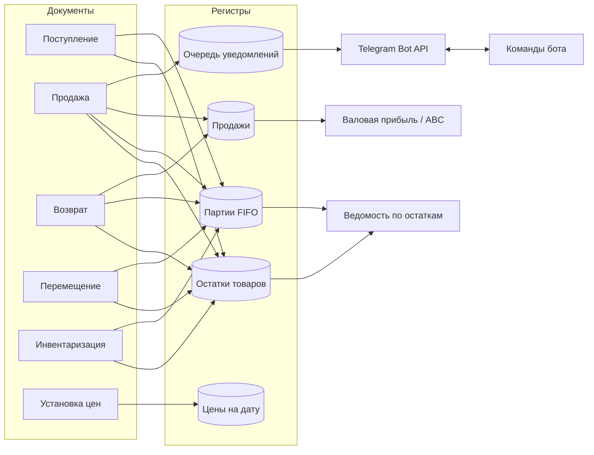

# Мини-розница на 1С:Предприятие 8.3


Конфигурация для розничного магазина: учёт по складам, себестоимость по партиям (FIFO), цены на дату, отчёты на СКД, печатные формы, загрузка номенклатуры из CSV и Telegram-бот, который присылает уведомления о продажах и отвечает на вопросы о магазине. Все ключевые сценарии покрыты автотестами, которые запускаются из командной строки и выдают отчёт JUnit.

> Проект показывает типовые задачи разработчика 1С на небольшом, но цельном примере: проведение с управляемыми блокировками и контролем остатков, партионный учёт, СКД, интеграция по HTTP и автоматизированное тестирование.

## Что умеет

**Склад и закупки**
- поступление от поставщиков, перемещение между складами, инвентаризация с излишками и недостачами;
- контроль остатков при проведении: продать или переместить больше, чем есть, нельзя (`Не хватает товара "Кофе Кения АА" на складе "Магазин на Ленина": 2 шт.`);
- нельзя отменить проведение поступления, если товар уже продан;
- себестоимость по FIFO: партии списываются от ранних к поздним, при перемещении партии переезжают со своей стоимостью.

**Продажи**
- продажа со скидкой клиента и способом оплаты (наличные, карта, СБП), печать кассового чека;
- возврат от покупателя на основании продажи: по цене продажи, по себестоимости продажи, не больше проданного;
- регистр продаж с выручкой и себестоимостью: валовая прибыль считается без пересчётов.

**Цены**
- розничные цены на дату в периодическом регистре, документ установки цен;
- если цены на дату нет, используется базовая цена из карточки товара.

**Отчёты (СКД)**
- «Валовая прибыль»: выручка, себестоимость, прибыль и наценка по товарам за период;
- «Ведомость по остаткам»: количество и себестоимость остатков по складам;
- «ABC-анализ продаж»: товары A (80% выручки), B (15%), C (5%).

**Интеграции**
- загрузка номенклатуры из CSV (выгрузка из Excel): группы, штрихкоды, цены, повторная загрузка обновляет товары;
- уведомление о каждой продаже в Telegram по схеме transactional outbox;
- Telegram-бот: `/prodazhi`, `/top`, `/malo`, `/ostatki кофе` и ежедневная сводка в 21:00 регламентным заданием.

**Администрирование**
- дата запрета изменения: закрытый период нельзя править задним числом (подписка на события);
- демо-данные: магазин кофе и чая с историей продаж за 2 месяца одной командой.

## Как это выглядит в Telegram

Примеры ниже — реальный вывод на демо-данных (`botpreview`).

```
🛒 Продажа №000000399 на 1 899,00 ₽
Магазин на Ленина · Наличные
Клиент: Татьяна Белова (скидка 10%)

• Шоколад горький 85% 100 г × 3 = 648,00 ₽
• Термокружка 450 мл × 1 = 1 251,00 ₽
```

```
> /prodazhi
📊 Продажи за 24.10.2026
Чеков: 10
Выручка: 19 637,50 ₽
Себестоимость: 10 678,00 ₽
Валовая прибыль: 8 959,50 ₽
Средний чек: 1 963,75 ₽
  • Банковская карта: 16 288,50 ₽
  • Наличные: 3 349,00 ₽

> /top
🏆 Топ-5 товаров за 7 дней
1. Кофе Эспрессо-смесь 1 кг — 11 шт., 19 491,00 ₽
2. Кофемолка ручная — 7 шт., 17 430,00 ₽
3. Кофе Бразилия Сантос 1 кг — 8 шт., 15 708,00 ₽
4. Кофе без кофеина 250 г — 21 шт., 13 972,50 ₽
5. Сиропы ассорти 3 × 250 мл — 15 шт., 13 127,50 ₽

> /malo
⚠️ Заканчиваются (осталось 3 шт. и меньше)
• Кофе без кофеина 250 г — 1 шт. (Склад на Промышленной)
• Кофемолка ручная — 2 шт. (Склад на Промышленной)
• Термокружка 450 мл — 1 шт. (Склад на Промышленной)
```

## Архитектура



Ключевые решения, подробно в [docs/architecture.md](docs/architecture.md):

| Решение | Почему |
|---|---|
| Общий механизм проведения в `УчетТоваровСервер` | Все складские документы проводятся одинаково: очистка старых движений → управляемая блокировка → движения → контроль минусов одним запросом |
| Исключительная управляемая блокировка по «склад × товар» | Два кассира не продадут последний товар одновременно, продажи других товаров идут параллельно |
| Два регистра остатков: количество и партии | Контроль остатков по узкому регистру, себестоимость по детальному |
| Transactional outbox для Telegram | Сообщение не уйдёт об откатившейся продаже, а медленный HTTP не держит блокировки остатков |
| Цены в периодическом регистре | Цена — значение во времени: история изменений и цена на любую дату |
| Себестоимость только в регистрах | Изменения реквизитов в `ОбработкаПроведения` не записываются, поэтому источник истины — движения |
| Печатные формы кодом, без макетов | Легко читать в Git и проверять автотестами |

## Структура проекта

```
src/                          выгрузка конфигурации (Конфигуратор → Выгрузить конфигурацию в файлы)
  CommonModules/
    УчетТоваровСервер         блокировки, остатки, контроль минусов, FIFO
    ЦенообразованиеСервер     цены на дату одним запросом
    ТелеграмСервер            Bot API, очередь уведомлений
    ТелеграмБот               команды бота, сводки
    ПечатьСервер              чек, приходная накладная
    ЗагрузкаДанныхСервер      разбор CSV, загрузка номенклатуры
    ДатаЗапретаИзменения      закрытый период
    ДемоДанные                магазин с историей за 2 месяца
    Самопроверка              служебные режимы запуска, раннер тестов
    Тесты*                    26 автотестов
  Documents/  Catalogs/  AccumulationRegisters/  InformationRegisters/  Reports/ ...
tools/build-and-test.ps1      сборка в чистую базу, проверка модулей, автотесты
samples/tovary.csv            пример файла для загрузки
docs/                         архитектура
```

## Как запустить

1. Создайте пустую файловую базу и загрузите конфигурацию: Конфигуратор → *Конфигурация → Загрузить конфигурацию из файлов* → папка `src` → *Обновить конфигурацию базы данных* (F7).
2. Заполните демо-данные (или работайте со своими). На чистой базе это занимает около 15 секунд: 24 товара, 12 клиентов, 2 склада, около 400 продаж за 60 дней, перемещения, возвраты и инвентаризация.

```
1cv8 ENTERPRISE /F "<база>" /C "demo"
```

3. Подключите Telegram (необязательно): создайте бота у @BotFather, напишите ему /start и сохраните токен и ID чата. Регламентные задания включатся сами:

```
1cv8 ENTERPRISE /F "<база>" /C "settings;token=<токен>;chat=<ID чата>;shop=Моя кофейня"
```

Другие служебные режимы: `import;file=samples\tovary.csv` — загрузка товаров, `bot;seconds=600` — бот для файловой базы без регламентных заданий, `botpreview;out=bot.txt` — ответы бота без Telegram.

## Автотесты

```powershell
.\tools\build-and-test.ps1
# с проверкой реальной отправки в Telegram:
.\tools\build-and-test.ps1 -TelegramToken <токен> -TelegramChat <ID чата>
```

Скрипт создаёт чистую базу в `build\`, загружает `src`, проверяет синтаксис модулей и запускает тесты. Протокол пишется в `build\tests.txt` и `build\junit.xml`.

```
RESULT: PASSED
Тестов: 26, успешно: 26, пропущено: 0, ошибок: 0

OK   ТестыУчетаТоваров.ПродажаСписываетПартииПоFIFO
OK   ТестыУчетаТоваров.ПерепроведениеПродажиНеЗадваиваетДвижения
OK   ТестыУчетаТоваров.ВозвратВосстанавливаетОстатокПоСебестоимостиПродажи
OK   ТестыУчетаТоваров.ПеремещениеПереноситПартииССебестоимостью
OK   ТестыУчетаТоваров.ОтменаПоступленияПроданногоТовараЗапрещена
OK   ТестыЦенИОтчетов.ОтчетABCКлассифицируетТовары
OK   ТестыИнтеграций.ЗагрузкаCSVСоздаетИОбновляетТоварыИЦены
OK   ТестыИнтеграций.ПроведениеПродажиСтавитУведомлениеВОчередь
...
```

## Развитие

- [ ] резервирование товаров под заказ клиента
- [ ] роли и права: кассир, кладовщик, администратор
- [ ] HTTP-сервис для сайта: остатки и цены в JSON
- [ ] обмен с маркетплейсами (остатки на Wildberries/Ozon)

Платформа: 1С:Предприятие 8.3.27, режим совместимости 8.3.27, управляемое приложение.
