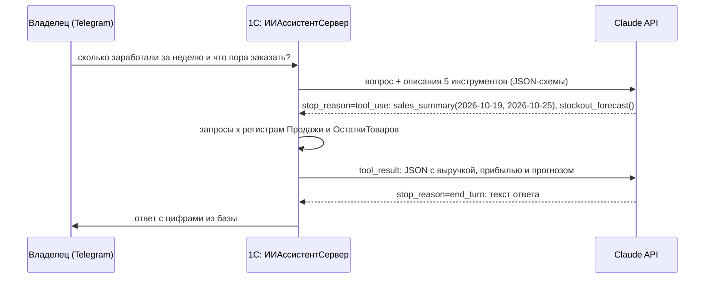
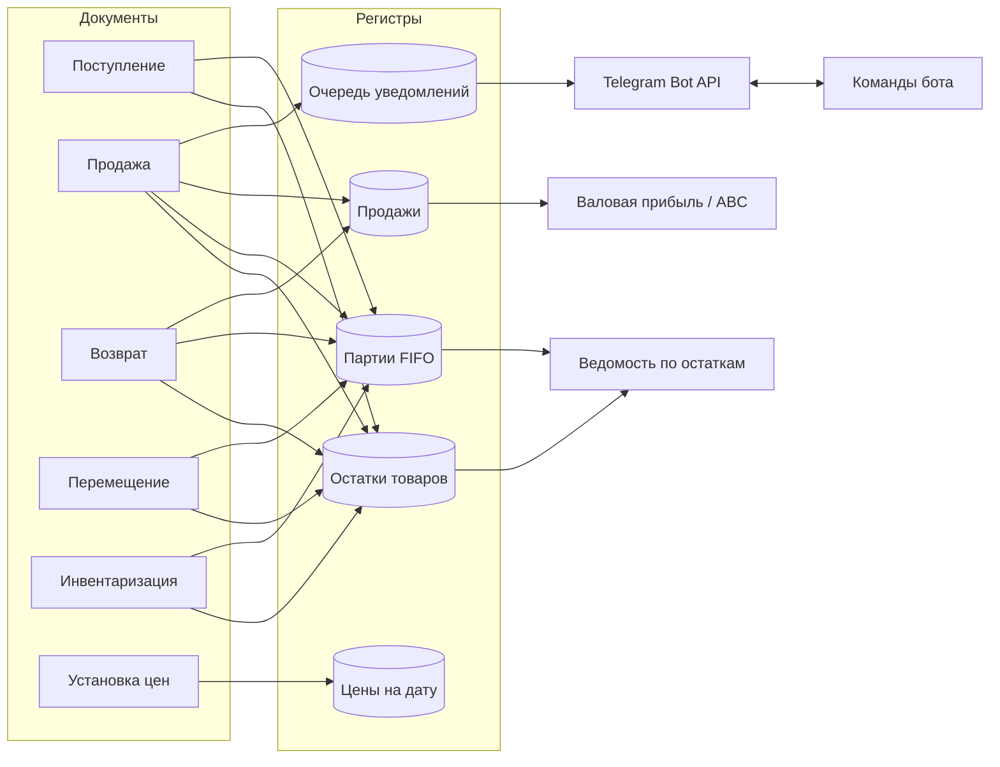

# Мини-розница на 1С:Предприятие 8.3


Конфигурация для розничного магазина: учёт по складам, себестоимость по партиям (FIFO), цены на дату, отчёты на СКД, печатные формы, загрузка номенклатуры из CSV и Telegram-бот, который присылает уведомления о продажах и отвечает на вопросы о магазине. Владелец может спросить бота обычными словами: ИИ-ассистент на Claude API сам вызывает функции 1С и отвечает по реальным данным. Есть прогноз дефицита с автозаказом, самодиагностика учёта и REST API для сайта. Все ключевые сценарии покрыты автотестами, которые запускаются из командной строки и выдают отчёт JUnit.

> Проект показывает типовые задачи разработчика 1С на небольшом, но цельном примере: проведение с управляемыми блокировками и контролем остатков, партионный учёт, СКД, интеграции по HTTP (Telegram, LLM, собственный REST API) и автоматизированное тестирование.

## Необычные фишки

**🤖 ИИ-ассистент с вызовом функций 1С (Claude API, tool use).** Владелец пишет боту «сколько заработали за неделю и что пора заказать?». Модель не получает базу целиком, а видит пять инструментов с JSON-схемами: продажи за период, поиск остатков, топ товаров, прогноз дефицита, самодиагностика. Модель сама решает, что вызвать, 1С выполняет вызовы своими запросами, и так по кругу, пока не будет готов ответ. Цифры в ответе берутся только из базы. Цикл агента покрыт автотестами на заготовленных ответах API, поэтому тесты не требуют сети и ключа.

**🔮 Прогноз дефицита и автозаказ.** Для каждого товара на каждом складе считается спрос в день (свежая неделя весит столько же, сколько весь месяц), на сколько дней хватит остатка и сколько заказать на 21 день вперёд. Команда `/zakaz` создаёт черновики поступлений, сгруппированные по складу и поставщику, с ценой последней закупки. Закупщику остаётся проверить их и провести.

**🩺 Самодиагностика учёта.** Остатки ведутся в двух регистрах параллельно, поэтому ошибка в проведении сразу видна как расхождение между ними. Проверка ищет расхождения, отрицательные остатки, стоимость без количества и застрявшие уведомления. Запуск: `/health` в боте или `GET /api/v1/health`.

**🚨 Контроль подозрительных продаж.** Если товар продан ниже себестоимости или со скидкой больше 20%, владельцу в Telegram уходит отдельная тревога. Себестоимость при этом точная, по FIFO, а не «примерно».

**🌐 REST API для сайта и маркетплейсов.** HTTP-сервис `/api/v1/stock`, `/prices`, `/forecast`, `/health` с доступом по ключу `X-API-Key`. Пока ключ не задан, API закрыт. Логика вынесена в общий модуль и покрыта тестами без веб-сервера.

## Что умеет

**Склад и закупки**
- поступление от поставщиков, перемещение между складами, инвентаризация с излишками и недостачами;
- контроль остатков при проведении: продать или переместить больше, чем есть, нельзя (`Не хватает товара "Кофе Кения АА" на складе "Магазин на Ленина": 2 шт.`);
- нельзя отменить проведение поступления, если товар уже продан;
- себестоимость по FIFO: партии списываются от ранних к поздним, при перемещении партии переезжают со своей стоимостью.

**Продажи**
- продажа со скидкой клиента и способом оплаты (наличные, карта, СБП), печать кассового чека;
- возврат от покупателя на основании продажи: по цене продажи, по себестоимости продажи, не больше проданного;
- регистр продаж с выручкой и себестоимостью: валовая прибыль считается без пересчётов.

**Цены**
- розничные цены на дату в периодическом регистре, документ установки цен;
- если цены на дату нет, используется базовая цена из карточки товара.

**Отчёты (СКД)**
- «Валовая прибыль»: выручка, себестоимость, прибыль и наценка по товарам за период;
- «Ведомость по остаткам»: количество и себестоимость остатков по складам;
- «ABC-анализ продаж»: товары A (80% выручки), B (15%), C (5%).

**Интеграции**
- загрузка номенклатуры из CSV (выгрузка из Excel): группы, штрихкоды, цены, повторная загрузка обновляет товары;
- уведомление о каждой продаже в Telegram по схеме transactional outbox;
- Telegram-бот: `/prodazhi`, `/top`, `/malo`, `/ostatki кофе` и ежедневная сводка в 21:00 регламентным заданием.

**Администрирование**
- дата запрета изменения: закрытый период нельзя править задним числом (подписка на события);
- демо-данные: магазин кофе и чая с историей продаж за 2 месяца одной командой.

## Как это выглядит в Telegram

Примеры ниже — реальный вывод на демо-данных (`botpreview`).

```
🛒 Продажа №000000399 на 1 899,00 ₽
Магазин на Ленина · Наличные
Клиент: Татьяна Белова (скидка 10%)

• Шоколад горький 85% 100 г × 3 = 648,00 ₽
• Термокружка 450 мл × 1 = 1 251,00 ₽
```

```
> /prodazhi
📊 Продажи за 24.10.2026
Чеков: 10
Выручка: 19 637,50 ₽
Себестоимость: 10 678,00 ₽
Валовая прибыль: 8 959,50 ₽
Средний чек: 1 963,75 ₽
  • Банковская карта: 16 288,50 ₽
  • Наличные: 3 349,00 ₽

> /top
🏆 Топ-5 товаров за 7 дней
1. Кофе Эспрессо-смесь 1 кг — 11 шт., 19 491,00 ₽
2. Кофемолка ручная — 7 шт., 17 430,00 ₽
3. Кофе Бразилия Сантос 1 кг — 8 шт., 15 708,00 ₽
4. Кофе без кофеина 250 г — 21 шт., 13 972,50 ₽
5. Сиропы ассорти 3 × 250 мл — 15 шт., 13 127,50 ₽

> /malo
⚠️ Заканчиваются (осталось 3 шт. и меньше)
• Кофе без кофеина 250 г — 1 шт. (Склад на Промышленной)
• Кофемолка ручная — 2 шт. (Склад на Промышленной)
• Термокружка 450 мл — 1 шт. (Склад на Промышленной)

> /prognoz
🔮 Прогноз дефицита (заказ, если товара меньше чем на 7 дн.)
• Кофе Бразилия Сантос 1 кг (Склад на Промышленной): уже закончился → заказать 2 шт.
• Кофе Бразилия Сантос 1 кг (Магазин на Ленина): осталось 3 шт., хватит на 2,6 дн. → заказать 22 шт.
• Кофе Эспрессо-смесь 1 кг (Магазин на Ленина): осталось 7 шт., хватит на 5,3 дн. → заказать 21 шт.
• Кружка керамическая 350 мл (Склад на Промышленной): осталось 2 шт., хватит на 5,9 дн. → заказать 6 шт.

> /health
🩺 Учёт в порядке ✅
Остатки сходятся с партиями, отрицательных остатков нет: да
```

### Как ИИ-ассистент отвечает на вопрос



Модель видит только то, что вернули инструменты, и только в объёме, нужном для ответа. Если модель вызовет несуществующий инструмент или передаст дату в неверном формате, 1С вернёт ей ошибку (`is_error`), и модель исправится сама: этот сценарий тоже есть в тестах.

## REST API

```bash
# проверка здоровья учёта, без ключа
curl http://localhost/retail/hs/api/v1/health
# остатки по артикулу или части названия
curl -H "X-API-Key: <ключ>" "http://localhost/retail/hs/api/v1/stock?q=кофе"
# цены на сегодня и прогноз дефицита
curl -H "X-API-Key: <ключ>" "http://localhost/retail/hs/api/v1/prices?sku=CF-004"
curl -H "X-API-Key: <ключ>" http://localhost/retail/hs/api/v1/forecast
```

```json
{
	"items": [
		{ "sku": "CF-004", "name": "Кофе Эспрессо-смесь 1 кг", "warehouse": "Магазин на Ленина", "qty": 7 }
	]
}
```

HTTP-сервис публикуется на веб-сервере (Apache или IIS) через Конфигуратор: *Администрирование → Публикация на веб-сервере*. Учебная версия платформы не публикует базы, поэтому методы API проверяются автотестами напрямую, без веб-сервера.

## Архитектура



Ключевые решения, подробно в [docs/architecture.md](docs/architecture.md):

| Решение | Почему |
|---|---|
| Общий механизм проведения в `УчетТоваровСервер` | Все складские документы проводятся одинаково: очистка старых движений → управляемая блокировка → движения → контроль минусов одним запросом |
| Исключительная управляемая блокировка по «склад × товар» | Два кассира не продадут последний товар одновременно, продажи других товаров идут параллельно |
| Два регистра остатков: количество и партии | Контроль остатков по узкому регистру, себестоимость по детальному |
| Transactional outbox для Telegram | Сообщение не уйдёт об откатившейся продаже, а медленный HTTP не держит блокировки остатков |
| Цены в периодическом регистре | Цена — значение во времени: история изменений и цена на любую дату |
| Себестоимость только в регистрах | Изменения реквизитов в `ОбработкаПроведения` не записываются, поэтому источник истины — движения |
| Печатные формы кодом, без макетов | Легко читать в Git и проверять автотестами |

## Структура проекта

```
src/                          выгрузка конфигурации (Конфигуратор → Выгрузить конфигурацию в файлы)
  CommonModules/
    УчетТоваровСервер         блокировки, остатки, контроль минусов, FIFO
    ЦенообразованиеСервер     цены на дату одним запросом
    ТелеграмСервер            Bot API, очередь уведомлений
    ТелеграмБот               команды бота, сводки
    ИИАссистентСервер         ИИ-ассистент: Claude API, инструменты, цикл агента
    ПрогнозЗапасовСервер      прогноз дефицита, черновики заказов
    ДиагностикаСервер         самодиагностика учёта, тревоги по продажам
    ВебAPIСервер              REST API: остатки, цены, прогноз, health
    ПечатьСервер              чек, приходная накладная
    ЗагрузкаДанныхСервер      разбор CSV, загрузка номенклатуры
    ДатаЗапретаИзменения      закрытый период
    ДемоДанные                магазин с историей за 2 месяца
    Самопроверка              служебные режимы запуска, раннер тестов
    Тесты*                    39 автотестов
  HTTPServices/ВебAPI         HTTP-сервис /api/v1/...
  Documents/  Catalogs/  AccumulationRegisters/  InformationRegisters/  Reports/ ...
tools/build-and-test.ps1      сборка в чистую базу, проверка модулей, автотесты
samples/tovary.csv            пример файла для загрузки
docs/                         архитектура
```

## Как запустить

1. Создайте пустую файловую базу и загрузите конфигурацию: Конфигуратор → *Конфигурация → Загрузить конфигурацию из файлов* → папка `src` → *Обновить конфигурацию базы данных* (F7).
2. Заполните демо-данные (или работайте со своими). На чистой базе это занимает около 15 секунд: 24 товара, 12 клиентов, 2 склада, около 400 продаж за 60 дней, перемещения, возвраты и инвентаризация.

```
1cv8 ENTERPRISE /F "<база>" /C "demo"
```

3. Подключите Telegram (необязательно): создайте бота у @BotFather, напишите ему /start и сохраните токен и ID чата. Регламентные задания включатся сами:

```
1cv8 ENTERPRISE /F "<база>" /C "settings;token=<токен>;chat=<ID чата>;shop=Моя кофейня"
```

Другие служебные режимы: `import;file=samples\tovary.csv` — загрузка товаров, `bot;seconds=600` — бот для файловой базы без регламентных заданий, `botpreview;out=bot.txt` — ответы бота без Telegram, `ask;q=<вопрос>;out=ask.txt` — вопрос ИИ-ассистенту из командной строки.

4. Подключите ИИ-ассистента и REST API (необязательно): ключ Claude API берётся в console.anthropic.com, ключ REST API придумайте сами.

```n1cv8 ENTERPRISE /F "<база>" /C "settings;claude=<ключ Claude API>;apikey=<ключ REST API>"
```

Модель по умолчанию — `claude-opus-5-5`, другую можно задать параметром `model=`.

## Автотесты

```powershell
.\tools\build-and-test.ps1
# с проверкой реальной отправки в Telegram и реального запроса к Claude:
.\tools\build-and-test.ps1 -TelegramToken <токен> -TelegramChat <ID чата> -ClaudeKey <ключ>
```

Скрипт создаёт чистую базу в `build\`, загружает `src`, проверяет синтаксис модулей и запускает тесты. Протокол пишется в `build\tests.txt` и `build\junit.xml`.

```
RESULT: PASSED
Тестов: 39, успешно: 37, пропущено: 2, ошибок: 0

OK   ТестыУчетаТоваров.ПродажаСписываетПартииПоFIFO
OK   ТестыУчетаТоваров.ПерепроведениеПродажиНеЗадваиваетДвижения
OK   ТестыУчетаТоваров.ВозвратВосстанавливаетОстатокПоСебестоимостиПродажи
OK   ТестыУчетаТоваров.ПеремещениеПереноситПартииССебестоимостью
OK   ТестыУчетаТоваров.ОтменаПоступленияПроданногоТовараЗапрещена
OK   ТестыЦенИОтчетов.ОтчетABCКлассифицируетТовары
OK   ТестыИнтеграций.ЗагрузкаCSVСоздаетИОбновляетТоварыИЦены
OK   ТестыИнтеграций.ПроведениеПродажиСтавитУведомлениеВОчередь
OK   ТестыНовыхВозможностей.ПрогнозСчитаетСпросДниИЗаказ
OK   ТестыНовыхВозможностей.ДиагностикаНаходитРасхождениеРегистров
OK   ТестыНовыхВозможностей.ПродажаНижеСебестоимостиСтавитТревогу
OK   ТестыНовыхВозможностей.ИИАгентВызываетИнструментИОтвечает
OK   ТестыНовыхВозможностей.ИИАгентПереживаетОшибкуИнструмента
OK   ТестыНовыхВозможностей.APIОтдаётОстаткиИЦеныВJSON
...
SKIP ТестыИнтеграций.ОтправкаСообщенияВTelegram       (нужны токен и чат)
SKIP ТестыНовыхВозможностей.ИИРеальныйЗапросКClaude   (нужен ключ Claude API)
```

## Развитие

- [ ] резервирование товаров под заказ клиента
- [ ] роли и права: кассир, кладовщик, администратор
- [x] HTTP-сервис для сайта: остатки и цены в JSON
- [x] ИИ-ассистент с вызовом функций 1С
- [x] прогноз дефицита и черновики заказов
- [ ] документ «Заказ поставщику» вместо черновиков поступлений
- [ ] ИИ-ассистент: история диалога, чтобы задавать уточняющие вопросы
- [ ] обмен с маркетплейсами (остатки на Wildberries/Ozon)

Платформа: 1С:Предприятие 8.3.27, режим совместимости 8.3.27, управляемое приложение.
