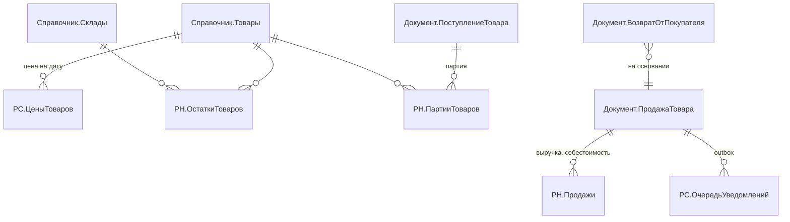
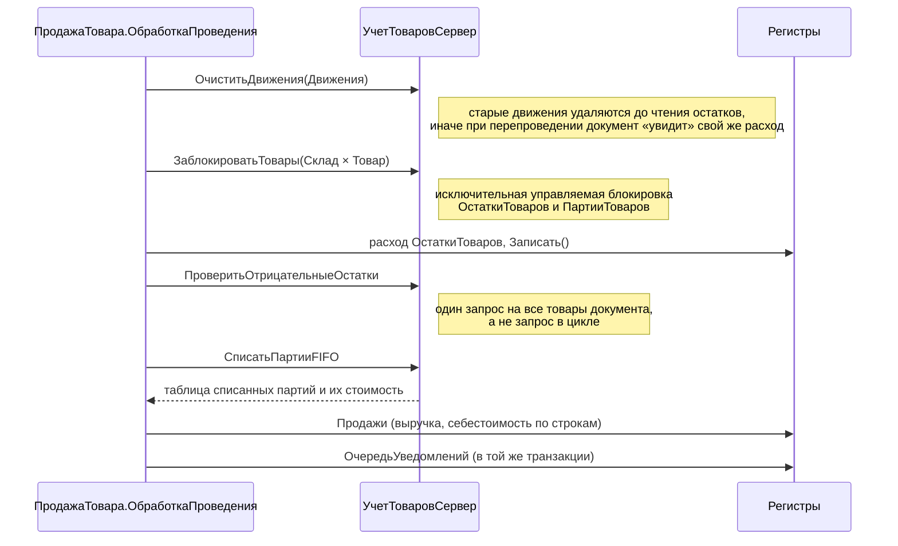
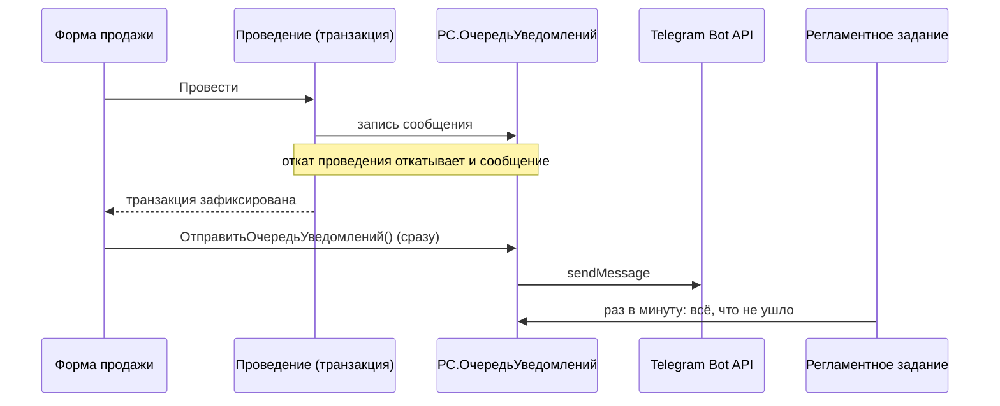

# Архитектура

Документ описывает, как устроены учёт, проведение документов и интеграции, и почему выбраны именно такие решения.

## Модель данных



| Регистр | Вид | Измерения | Ресурсы | Зачем |
|---|---|---|---|---|
| `ОстаткиТоваров` | накопления, остатки | Склад, Товар | Количество | быстрый контроль остатков |
| `ПартииТоваров` | накопления, остатки | Склад, Товар, Партия | Количество, Стоимость | себестоимость по FIFO |
| `Продажи` | накопления, обороты | Склад, Товар, Клиент, СпособОплаты | Количество, Выручка, Себестоимость | отчёты о прибыли |
| `ЦеныТоваров` | сведений, периодический (день), подчинён регистратору | Товар | Цена | розничная цена на дату |
| `ОчередьУведомлений` | сведений, независимый | Идентификатор | Текст, Источник, ДатаСоздания, КоличествоПопыток, ПоследняяОшибка | transactional outbox |

Остатки хранятся в двух регистрах сознательно. `ОстаткиТоваров` — узкий и быстрый: по нему контролируются минусы. `ПартииТоваров` — детальный, нужен только для расчёта себестоимости. Отчёты по количеству не обязаны агрегировать партии.

## Проведение расходного документа

Все складские документы проводятся по одной схеме. Общая логика вынесена в `ОбщийМодуль.УчетТоваровСервер`, модули объектов остаются короткими.



**Почему контроль после записи движений.** Остатки читаются из регистра уже с учётом текущего документа, поэтому проверка «ушёл ли товар в минус» сводится к одному запросу `Остатки(, (Склад, Товар) В (...)) ГДЕ КоличествоОстаток < 0`. Её не нужно повторять для каждой строки, и она корректно работает, когда один товар встречается в нескольких строках.

**Почему блокировка.** Без неё два кассира одновременно прочитают остаток 1 и оба продадут последний товар. Исключительная управляемая блокировка по паре «склад, товар» сериализует только конкурирующие документы, а продажи других товаров идут параллельно.

**Отмена проведения** тоже проверяет минусы: нельзя отменить поступление уже проданного товара (`ОбработкаУдаленияПроведения`).

## Себестоимость: FIFO

`СписатьПартииFIFO` читает остатки партий по складу и товарам документа, упорядоченные по `Партия.МоментВремени`, и списывает их по очереди. Если партия уходит целиком, списывается вся её стоимость, иначе пропорция с округлением до копеек. Так ошибка округления не накапливается в остатке партии.

- **Перемещение** переносит партии на склад-получатель вместе с исходной партией и стоимостью. Порядок FIFO на новом складе сохраняется.
- **Возврат** приходует товар новой партией по себестоимости единицы из движений продажи (`РН.Продажи`, отбор по регистратору).
- **Инвентаризация** списывает недостачу по FIFO, а излишки приходуют партией по цене оценки (если цена не указана, берётся розничная на дату).

## Уведомления: transactional outbox



Отправлять HTTP-запрос прямо из `ОбработкаПроведения` нельзя по двум причинам:
1. Транзакция может откатиться после отправки, и в Telegram уйдёт сообщение о продаже, которой нет.
2. Пока ждём ответа Telegram, держатся блокировки остатков, и остальные кассиры ждут.

Поэтому документ только пишет сообщение в регистр в своей транзакции. Отправка идёт после фиксации: сразу из формы и раз в минуту регламентным заданием. Каждое сообщение отправляется в отдельной транзакции под исключительной блокировкой его ключа, поэтому форма и задание не отправят одно сообщение дважды. Неудачные попытки считаются, после 10 попыток сообщение остаётся в очереди для разбора.

## Telegram-бот

`ТелеграмБот.ОбработатьВходящиеКоманды` забирает обновления методом `getUpdates` со смещением `offset` (последний обработанный `update_id` хранится в константе) и отвечает на команды. Отвечает только в чат из настроек. Логика ответа (`ОтветНаКоманду`) не зависит от HTTP, поэтому покрыта автотестами.

| Команда | Ответ |
|---|---|
| `/prodazhi` | чеки, выручка, себестоимость, прибыль, средний чек, разбивка по способам оплаты за сегодня |
| `/top` | топ-5 товаров по выручке за 7 дней |
| `/malo` | товары с остатком 3 шт. и меньше по складам |
| `/ostatki [текст]` | остатки по складам с фильтром по названию |

Расписание: команды бота каждые 30 секунд, очередь уведомлений каждую минуту, сводка в 21:00. Для файловой базы без сервера есть режим `bot;seconds=N` с long polling.

## Цены

Цена — значение во времени, поэтому она хранится в периодическом регистре сведений, подчинённом документу `УстановкаЦенТоваров`. Получение цен на дату для набора товаров — один запрос: `СрезПоследних(&Дата, Товар В (&Товары))` с левым соединением к справочнику (если цены нет, используется базовая цена из карточки).

## Закрытый период

Подписка `ПроверкаДатыЗапретаИзменения` на `ПередЗаписью` всех документов не даёт менять документы с датой не позже `Константа.ДатаЗапретаИзменения`. Проверяется и новая дата, и дата в базе: иначе документ можно было бы «вытащить» из закрытого периода, поменяв ему дату. В режиме обмена (`ОбменДанными.Загрузка`) проверка не выполняется.

## ИИ-ассистент: Claude API и вызов инструментов

`ИИАссистентСервер` реализует цикл агента на Anthropic Messages API (`POST /v1/messages`, заголовки `x-api-key` и `anthropic-version`) без SDK, через `HTTPСоединение`.

1. В запрос уходят вопрос владельца, системная инструкция («цифры только из инструментов, без Markdown») и описания пяти инструментов с JSON-схемами: `sales_summary`, `stock_search`, `top_products`, `stockout_forecast`, `accounting_health`.
2. Если модели нужны данные, она отвечает `stop_reason = "tool_use"` и перечисляет вызовы. 1С выполняет каждый вызов своими запросами и возвращает все результаты одним сообщением `user` с блоками `tool_result`.
3. Цикл повторяется, пока модель не ответит `end_turn`, но не больше 6 шагов.

Почему так:

| Решение | Почему |
|---|---|
| Инструменты вместо выгрузки данных в промпт | Модель получает только нужное для ответа, а цифры берутся из запросов 1С, а не из «памяти» модели |
| `strict: true` и `additionalProperties: false` в схемах | API гарантирует, что аргументы соответствуют схеме, и 1С не разбирает мусор |
| Ответ модели возвращается в историю целиком | В нём могут быть блоки размышлений, API требует неизменной истории между шагами |
| Ошибка инструмента уходит модели как `is_error`, а не исключением | Модель видит, что пошло не так (неверная дата, неизвестный инструмент), и исправляет вызов сама |
| `effort: low` | Вопросы по данным магазина короткие, низкое усилие быстрее и дешевле |
| `fallbacks: "default"` | Если основная модель откажется отвечать, API сам повторит запрос на подходящей модели |
| Заготовленные ответы API в тестах | Цикл агента, разбор `tool_use` и формирование `tool_result` проверяются без сети и без ключа |

Ключ хранится в константе `ClaudeКлючAPI` в режиме пароля и в исходники не попадает.

## Прогноз дефицита

`ПрогнозЗапасовСервер.Прогноз` одним запросом собирает по складу и товару остаток и продажи за 28 и за 7 дней (объединение остатков и двух оборотов регистра `Продажи`).

```
Спрос в день = (Продано за 28 дней / 28 + Продано за 7 дней / 7) / 2
Дней хватит  = Остаток / Спрос в день
Заказать     = ⌈Спрос в день × 21 − Остаток⌉, если дней хватит меньше 7
```

Последняя неделя весит столько же, сколько месяц: прогноз быстро замечает рост спроса и не держится за давний всплеск. `СоздатьЧерновикиЗаказов` группирует рекомендации по складу и поставщику последней закупки и создаёт непроведённые поступления по цене последней закупки. Остатки не меняются, пока закупщик не проведёт документ.

## Самодиагностика и контроль продаж

`ДиагностикаСервер.ПроверитьУчет` сверяет два регистра остатков одним запросом: `ОстаткиТоваров` против суммы партий `ПартииТоваров` по складу и товару. Регистры пишутся одним и тем же проведением, поэтому любое расхождение указывает на ошибку в коде или на ручную правку движений. Дополнительно проверяются отрицательные остатки, стоимость партий при нулевом количестве и сообщения, застрявшие в очереди Telegram. Тест специально портит учёт движением мимо партий и проверяет, что расхождение найдено.

При первом проведении продажи `ТекстТревогиПоПродаже` сравнивает сумму каждой строки с себестоимостью FIFO, которую проведение уже посчитало. Продажа ниже себестоимости или со скидкой больше 20% ставит в outbox отдельную тревогу, в той же транзакции, что и обычное уведомление.

## REST API

HTTP-сервис `ВебAPI` (корень `/api`) содержит только обработчики-однострочники, вся логика в `ВебAPIСервер.Обработать(Метод, Параметры, Заголовки)`. Функция принимает обычные соответствия и возвращает код и тело JSON, поэтому тестируется без веб-сервера. Доступ по заголовку `X-API-Key` (сравнение без учёта регистра имени заголовка). Пока ключ в константе `ВебAPIКлюч` пуст, закрытые методы отвечают `503`: API нельзя опубликовать открытым по ошибке. `/health` доступен без ключа для мониторинга.

## Автотесты

Тест — экспортная процедура без параметров в общем модуле `Тесты*`, модуль отдаёт список тестов функцией `СписокТестов()`. Раннер в `Самопроверка` вызывает каждый тест в `Попытка`, собирает статусы и пишет текстовый протокол и JUnit XML.

- Тесты изолированы данными, а не транзакциями: каждый создаёт свой склад и товары с уникальными именами. Транзакции не подходят, потому что тесты проверяют отказ в проведении, а после исключения транзакция помечается как ошибочная.
- Тесты «за период» (отчёты, сводка бота) используют случайную уникальную дату, поэтому повторный прогон на той же базе не видит данных прошлых запусков.
- Проверка отправки в Telegram помечается `SKIP`, если токен не передан, реальный запрос к Claude — если не передан ключ.

`tools/build-and-test.ps1` повторяет то, что делал бы CI: чистая база → загрузка `src` → `/CheckModules` → автотесты.
